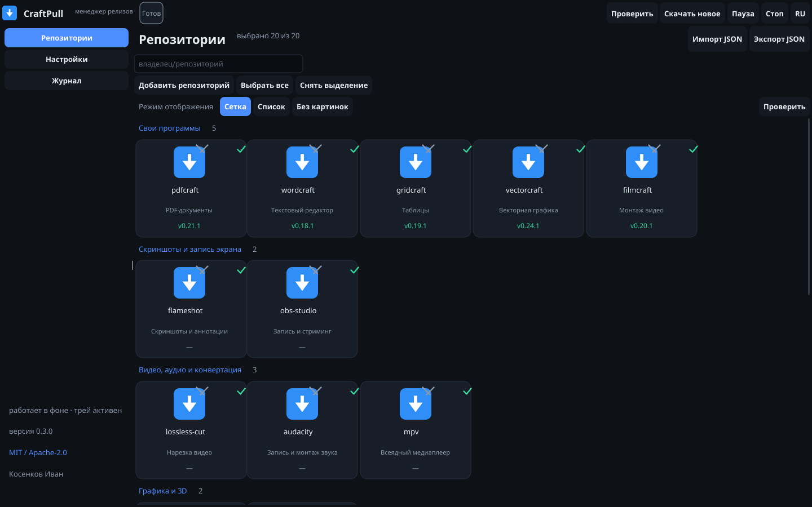
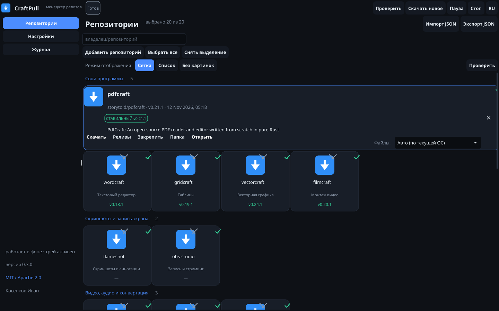
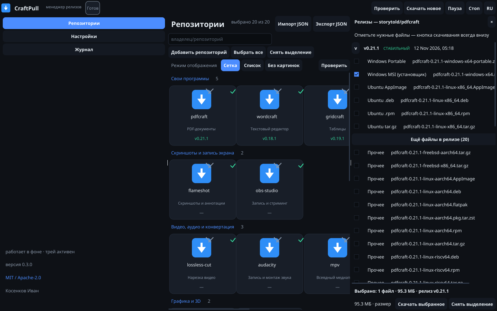
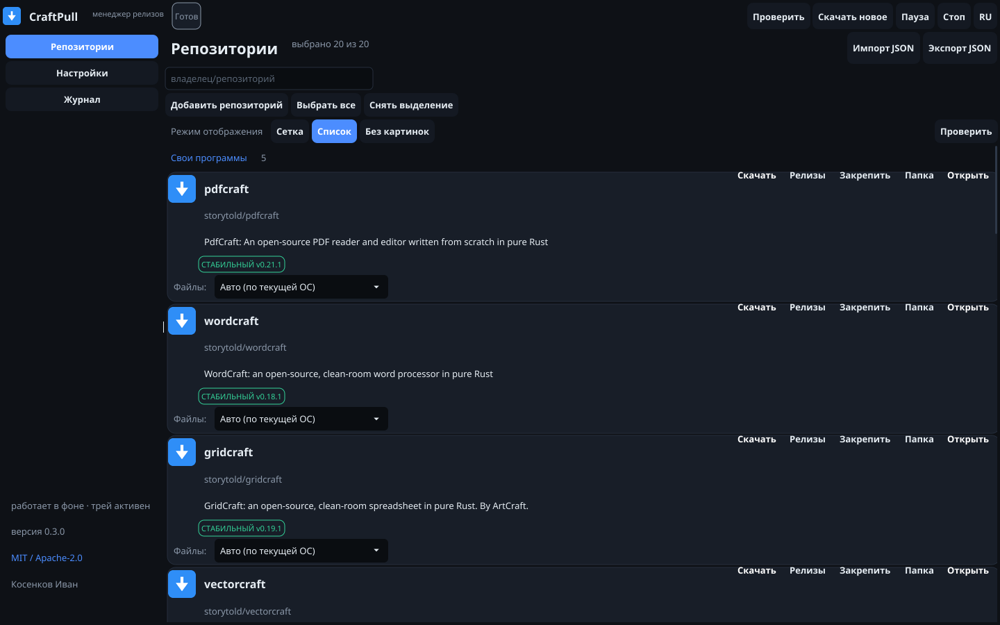
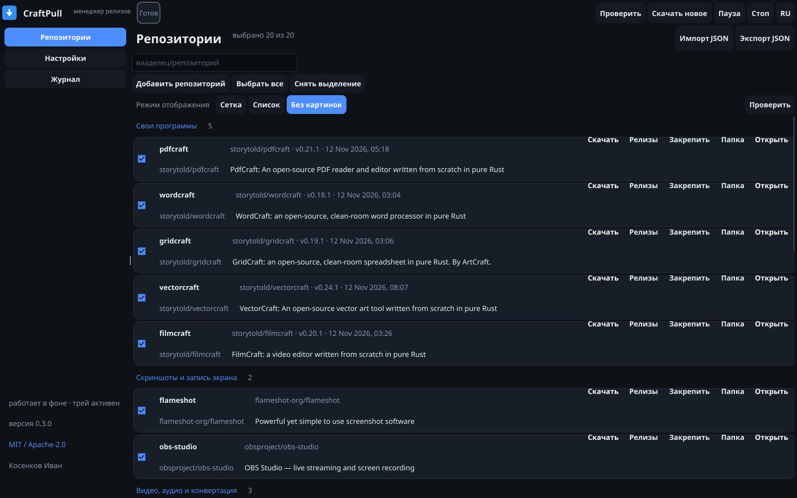
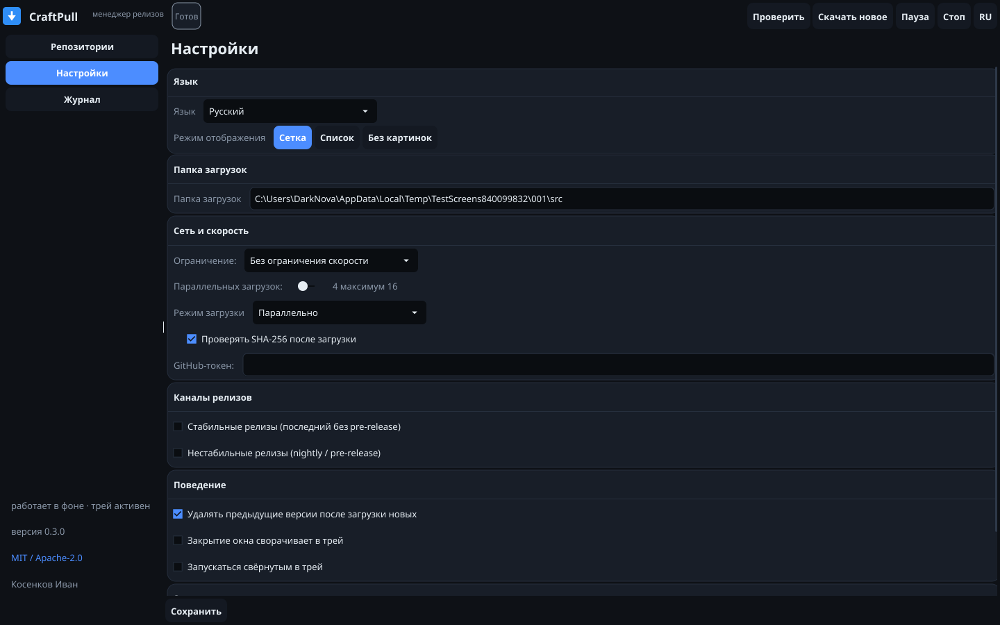
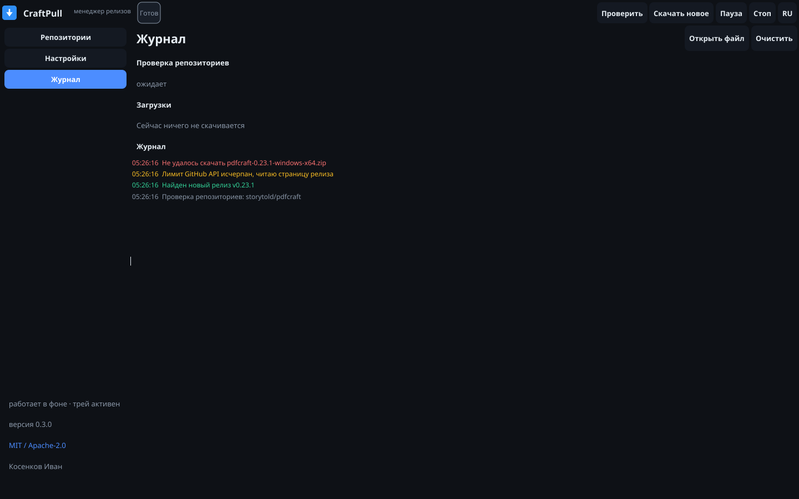

<div align="center">

  <h1>CraftPull <span style="font-size:0.6em">· Go edition</span></h1>

  <p><b>A release &amp; source manager for GitHub repositories</b><br>
  Native desktop GUI written in Go (Fyne) — no Electron, no web engine.</p>

  <p>
    <a href="README.md"><b>🇬🇧 English</b></a>
    &nbsp;·&nbsp;
    <a href="README.ru.md"><b>🇷🇺 Русский</b></a>
  </p>

  <p>
    
    
    
    
  </p>
</div>

---

## What it is

This repository is the **Go rewrite of CraftPull** — the same application that exists in the
[Rust edition](https://github.com/KosenkovPro/craftpuller), with the whole logic ported to Go
and the interface rebuilt on [Fyne](https://fyne.io).

CraftPull is a **desktop release manager for GitHub**. Point it at your repositories, and it
watches them for new releases, downloads the release assets (`zip`, `tar.gz`, `.dmg`, `.pkg`,
`.msi`, `.deb` or source archives), verifies their SHA-256 checksums and removes the outdated
versions — leaving the ones you pinned alone.

The configuration file is **format-compatible with the Rust edition**: the same
`config.json` can be copied between them without conversion.

## Features

* **Two channels per repository** — `STABLE` (the newest release without the pre-release flag)
  and `UNSTABLE` (pre-release / nightly / rc). If both channels exist, both are downloaded,
  and only after they succeed are the older versions removed.
* **Automatic file selection** — the file filter picks the build for the **current operating
  system** on its own, and every asset of a release can also be ticked by hand.
* **A short purpose for every program** — the tile says in one line what the program is for
  (`PDF-документы`, `Монтаж видео`, `Скриншоты и аннотации`). The text lives in the configuration
  file and travels with the repository list when it is exported and imported.
* **A ready-made catalog of 55 programs** — the list is grouped by category: screenshots and
  recording, video and audio, graphics and 3D, system and network, security and offline bases,
  self-hosted servers. Programs without binary releases on GitHub (Jellyfin, Nextcloud, Passbolt)
  are downloaded as source archives.
* **Self-cleaning storage** — old versions are deleted automatically once the new ones are on
  disk; a pinned release is never deleted, even manually.
* **Safe downloads** — resumable (HTTP `Range`), `.part` files, SHA-256 verification, a global
  speed limit, pause / resume / stop, and parallel downloads with a configurable limit.
* **Works without the API quota** — if the anonymous GitHub API quota is exhausted, CraftPull
  falls back to the public release pages.
* **System tray** — the window can be closed into the tray, started minimized, and controlled
  from the tray menu (show, pause, stop, quit).
* **Two languages** — English and Russian, switchable at any time.
* **Self-update** — the newest release is downloaded straight from GitHub and applied on exit.
* **Free license** — CraftPull is released under the dual `MIT / Apache-2.0` license; hovering the
  line in the sidebar explains what it allows.

## Screens

The interface repeats the design of the **Windows (Rust) edition** — the same palette, the same
header, the same tiles, cards and panels. The pictures show the Russian interface; the program
also speaks English — the language is switched in the settings or with the `RU` / `EN` button in
the header.



*Grid: every repository is a tile with its icon and version. The chevron at the icon opens the
list of releases, and the tick in the corner marks the repositories selected for downloading.*



*An unfolded card takes the place of its tile: the icon, the version, the channel, the description
and the buttons of the repository.*



*The release panel on the right: the files of a release are ticked by hand, and the build for the
current system is ticked automatically.*

| List | Without images | Settings | Log |
| --- | --- | --- | --- |
|  |  |  |  |

## Building

Fyne needs **cgo**, so the graphical build requires a C compiler:

| Platform | Requirements |
| --- | --- |
| Windows | Go 1.24+, [mingw-w64](https://www.mingw-w64.org/) (GCC) |
| macOS | Go 1.24+, Xcode command line tools (`xcode-select --install`) |
| Any (console mode) | Go 1.24+, `CGO_ENABLED=0` — no GUI, no C compiler |

### Windows

```powershell
go build -ldflags "-H windowsgui -s -w" -o dist\craftpull.exe .\cmd\craftpull
```

`-H windowsgui` hides the console window of the graphical build; `--help` and `--version`
still print their text — the program attaches to the parent console for them.

`gcc` must be reachable — either install mingw-w64 and put it on `PATH`, or point `CC` at it:

```powershell
$env:CC = "C:\mingw64\bin\gcc.exe"
$env:CGO_ENABLED = "1"
go build -o dist\craftpull.exe .\cmd\craftpull
```

### macOS — Intel, Apple Silicon and universal

```bash
scripts/build-macos.sh
```

The script builds `darwin/amd64` and `darwin/arm64` separately, joins them with `lipo` into a
universal binary and packs it into `CraftPull.app`. The individual steps:

```bash
CGO_ENABLED=1 GOOS=darwin GOARCH=amd64 go build -o dist/craftpull-darwin-amd64 ./cmd/craftpull
CGO_ENABLED=1 GOOS=darwin GOARCH=arm64 go build -o dist/craftpull-darwin-arm64 ./cmd/craftpull
lipo -create -output dist/craftpull-darwin-universal \
  dist/craftpull-darwin-amd64 dist/craftpull-darwin-arm64
scripts/make-app-bundle.sh dist/craftpull-darwin-universal dist/CraftPull.app
```

### macOS coverage

| macOS | Version | Build |
| --- | --- | --- |
| macOS 26 (Tahoe) | 26.x | universal (Go 1.26) |
| macOS 15 (Sequoia) | 15.x | universal (Go 1.26) |
| macOS 14 (Sonoma) | 14.x | universal (Go 1.26) |
| macOS 13 (Ventura) | 13.x | universal (Go 1.26) |
| macOS 12 (Monterey) | 12.x | universal (Go 1.26) |
| macOS 11 (Big Sur) | 11.x | universal legacy (Go 1.24) |

Go 1.25 and newer require **macOS 12**, so macOS 11 is covered by a separate *legacy* build
made with Go 1.24 — it is the same source code, only an older toolchain.

The universal binary contains both architectures and runs natively on Intel Macs and on
Apple Silicon.

### Console mode (no cgo)

```bash
CGO_ENABLED=0 go build -o dist/craftpull ./cmd/craftpull
```

Without cgo the program has no window: it prints the repository list, runs the check and the
download from the terminal. Useful on servers and in containers.

## Command line

```
craftpull                        open the window
craftpull --tray                 start minimized in the tray
craftpull --install-shortcut     install the program and create a shortcut
craftpull --export-icon <png>    save the application icon as PNG
craftpull --selftest [slug]      end-to-end check: query GitHub and download a release
craftpull --tab <repos|settings|logs>
craftpull --view <grid|list|light>
craftpull --popup <owner/repo>   open the releases panel of a repository
craftpull --hero <owner/repo>    open the grid with the card unfolded
craftpull --download <owner/repo>
craftpull --no-icons             do not download or show third-party icons
craftpull --no-refresh           do not contact GitHub on start, use the cache
craftpull --refresh              refresh the repositories even if the cache is fresh
craftpull --version
```

## Configuration

The settings live next to the program's data directory:

| Platform | Path |
| --- | --- |
| Windows | `%APPDATA%\CraftPull\config.json` |
| macOS | `~/Library/Application Support/CraftPull/config.json` |

The file is the **same JSON as in the Rust edition** — repositories, channels, download mode,
speed limit, parallel downloads, pinned versions, interface language and view mode. Every
repository also carries a short `purpose` («PDF-документы») and a `category` key that decides
in which group of the list it is shown; both travel with the list when it is exported and
imported.

## Continuous integration

`.github/workflows/build.yml` builds the project on every push:

* **Windows x64** — mingw-w64, cgo enabled, packed into a `zip`.
* **macOS Intel** (`macos-15-intel`) and **macOS Apple Silicon** (`macos-15`) — separate builds.
* **macOS universal** — `lipo` of both architectures, plus a `CraftPull.app` bundle, a `zip` and
  a `.dmg`.
* **macOS universal legacy** — the same universal build made with Go 1.24 for macOS 11.
* **Checks** — `go vet`, a no-cgo build and a cross-compilation check.

Tagging a commit with `v*` publishes all artifacts as a GitHub release.

## Repository layout

```
cmd/craftpull      command line entry point
internal/app       shared interface state
internal/buildinfo version information
internal/cache     release cache on disk
internal/config    settings, format-compatible with the Rust edition
internal/download  downloader, rate limiter, resume, SHA-256
internal/gh        GitHub client and public-page fallback
internal/i18n      English and Russian strings
internal/icon      procedurally drawn application icon
internal/icons     repository icon cache
internal/manager   business logic: checks, plans, downloads, cleanup
internal/model     data model
internal/selfupdate update from the GitHub release
internal/shortcut  desktop shortcut (Windows .lnk, macOS .app)
internal/storage   installed versions, metadata, cleanup
internal/ui        Fyne interface
scripts            build helpers
```

## License

MIT / Apache-2.0 — see [LICENSE](LICENSE).
