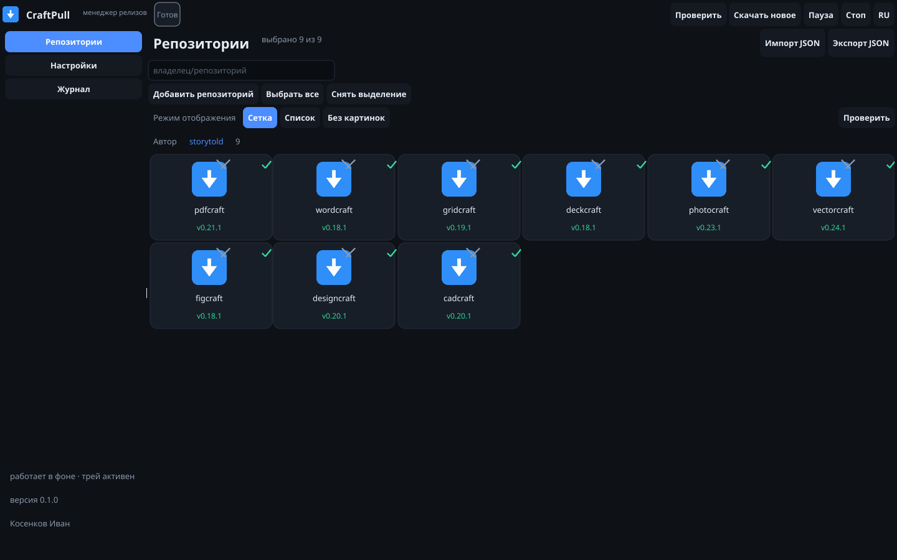
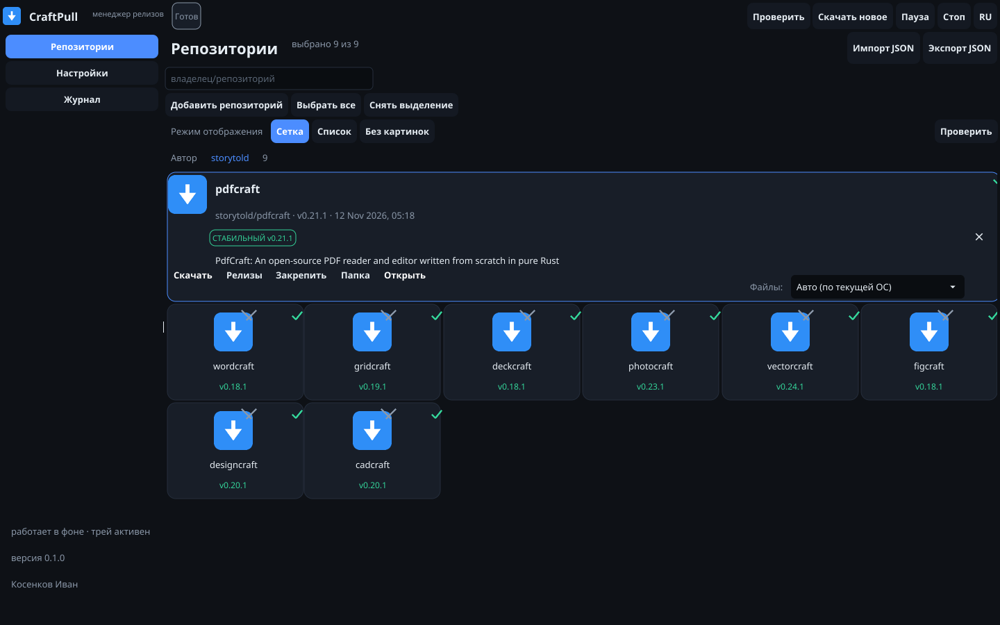
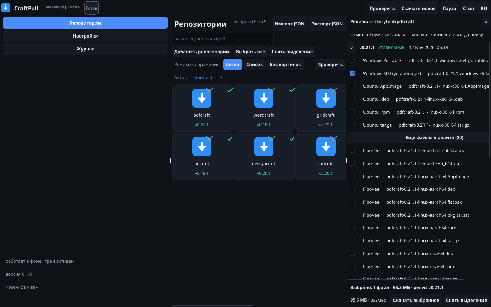
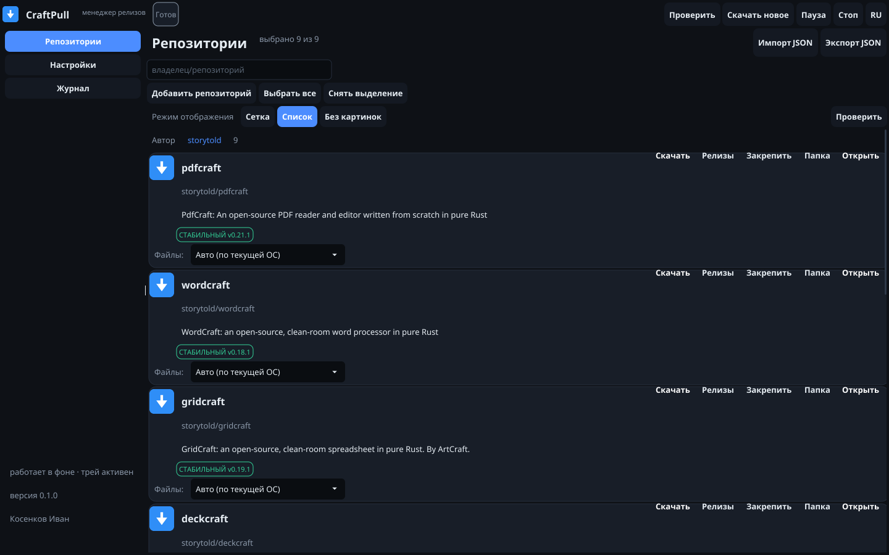
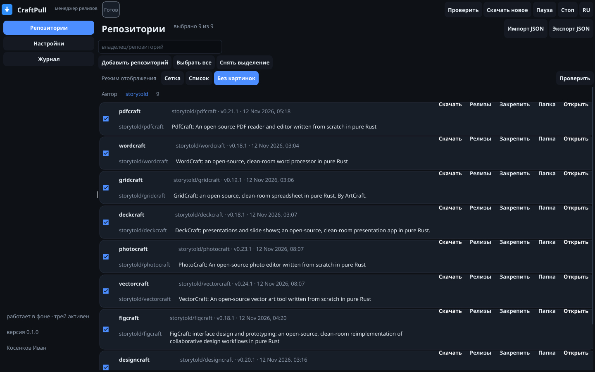
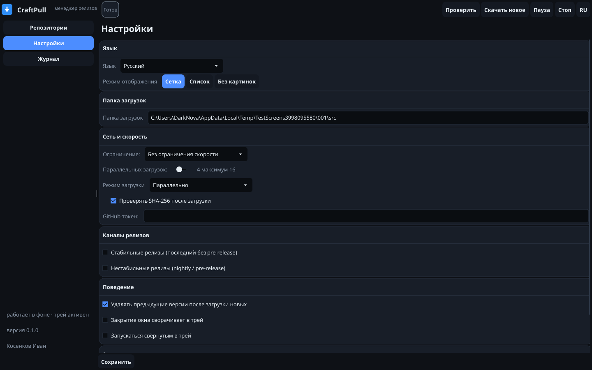
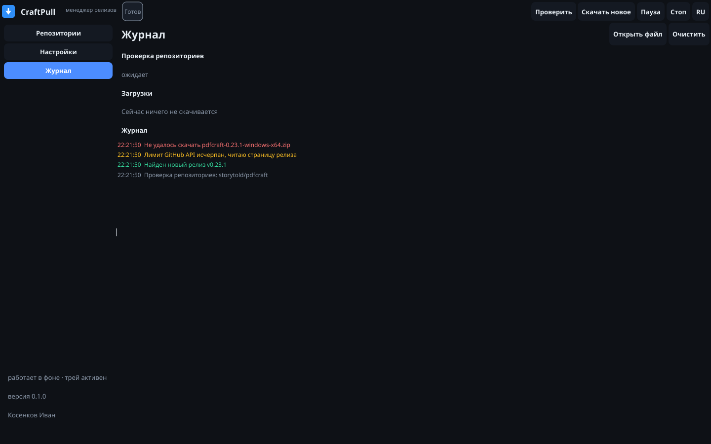

<div align="center">

  <h1>CraftPull <span style="font-size:0.6em">· версия на Go</span></h1>

  <p><b>Менеджер релизов и исходников для репозиториев GitHub</b><br>
  Нативное графическое приложение на Go (Fyne) — без Electron и без веб-движка.</p>

  <p>
    <a href="README.md"><b>🇬🇧 English</b></a>
    &nbsp;·&nbsp;
    <a href="README.ru.md"><b>🇷🇺 Русский</b></a>
  </p>

  <p>
    
    
    
    
  </p>
</div>

---

## Что это

Этот репозиторий — **переписанная на Go версия CraftPull**: то же приложение, что и
[Rust-версия](https://github.com/KosenkovPro/craftpuller), но вся логика перенесена на Go,
а интерфейс собран на [Fyne](https://fyne.io).

CraftPull — **настольный менеджер релизов для GitHub**. Укажите ему свои репозитории — и он
сам следит за новыми релизами, скачивает файлы релиза (`zip`, `tar.gz`, `.dmg`, `.pkg`, `.msi`,
`.deb` или архивы с исходниками), проверяет их контрольные суммы SHA-256 и удаляет устаревшие
версии — закреплённые вами версии остаются нетронутыми.

Файл настроек **совместим с Rust-версией**: тот же самый `config.json` переносится между
приложениями без конвертации.

## Возможности

* **Два канала у каждого репозитория** — `STABLE` (последний релиз без флага предварительного
  выпуска) и `UNSTABLE` (pre-release / nightly / rc). Если каналов два, скачиваются оба, и
  старые версии удаляются только после успешной загрузки новых.
* **Автоматический выбор файла** — фильтр сам подбирает сборку под **текущую операционную
  систему**, а любой файл релиза можно отметить и вручную.
* **Самоочищающееся хранилище** — старые версии удаляются автоматически после загрузки новых;
  закреплённый релиз не удаляется даже вручную.
* **Безопасная загрузка** — докачка через HTTP `Range`, временные файлы `.part`, проверка
  SHA-256, общее ограничение скорости, пауза / продолжение / остановка и параллельные загрузки
  с настраиваемым лимитом.
* **Работает без квоты API** — если анонимная квота GitHub исчерпана, CraftPull читает
  публичные страницы релизов.
* **Системный трей** — окно можно свернуть в трей, запускать свёрнутым и управлять из меню
  трея (показать, пауза, остановить, выход).
* **Два языка** — английский и русский, переключаются в любой момент.
* **Обновление** — новейший релиз скачивается прямо с GitHub и подставляется при выходе.

## Снимки экрана

Интерфейс повторяет дизайн **Windows-версии (Rust)** — та же палитра, та же шапка, те же плитки,
карточки и панели. На картинках русский интерфейс; программа говорит и по-английски — язык
переключается в настройках или кнопкой `RU` / `EN` в шапке окна.



*Сетка: каждый репозиторий — плитка со значком и версией. Уголок у значка открывает список
релизов, а галочка в углу отмечает репозитории, выбранные для загрузки.*



*Раскрытая карточка занимает место своей плитки: значок, версия, канал, описание и кнопки
репозитория.*



*Панель релизов справа: нужные файлы релиза отмечаются галочками, а сборка под текущую
операционную систему отмечается автоматически.*

| Список | Без картинок | Настройки | Журнал |
| --- | --- | --- | --- |
|  |  |  |  |

## Сборка

Fyne требует **cgo**, поэтому для графической сборки нужен C-компилятор:

| Платформа | Требования |
| --- | --- |
| Windows | Go 1.24+, [mingw-w64](https://www.mingw-w64.org/) (GCC) |
| macOS | Go 1.24+, инструменты командной строки Xcode (`xcode-select --install`) |
| Любая (консольный режим) | Go 1.24+, `CGO_ENABLED=0` — без окна и без C-компилятора |

### Windows

```powershell
go build -ldflags "-H windowsgui -s -w" -o dist\craftpull.exe .\cmd\craftpull
```

`gcc` должен быть доступен: либо установите mingw-w64 и добавьте его в `PATH`, либо укажите
компилятор через `CC`:

```powershell
$env:CC = "C:\mingw64\bin\gcc.exe"
$env:CGO_ENABLED = "1"
go build -o dist\craftpull.exe .\cmd\craftpull
```

### macOS — Intel, Apple Silicon и universal

```bash
scripts/build-macos.sh
```

Скрипт собирает `darwin/amd64` и `darwin/arm64` по отдельности, объединяет их через `lipo` в
universal-бинарник и упаковывает его в `CraftPull.app`. Отдельно эти шаги выглядят так:

```bash
CGO_ENABLED=1 GOOS=darwin GOARCH=amd64 go build -o dist/craftpull-darwin-amd64 ./cmd/craftpull
CGO_ENABLED=1 GOOS=darwin GOARCH=arm64 go build -o dist/craftpull-darwin-arm64 ./cmd/craftpull
lipo -create -output dist/craftpull-darwin-universal \
  dist/craftpull-darwin-amd64 dist/craftpull-darwin-arm64
scripts/make-app-bundle.sh dist/craftpull-darwin-universal dist/CraftPull.app
```

### Покрытие macOS

| macOS | Версия | Сборка |
| --- | --- | --- |
| macOS 26 (Tahoe) | 26.x | universal (Go 1.26) |
| macOS 15 (Sequoia) | 15.x | universal (Go 1.26) |
| macOS 14 (Sonoma) | 14.x | universal (Go 1.26) |
| macOS 13 (Ventura) | 13.x | universal (Go 1.26) |
| macOS 12 (Monterey) | 12.x | universal (Go 1.26) |
| macOS 11 (Big Sur) | 11.x | universal legacy (Go 1.24) |

Go 1.25 и новее требуют **macOS 12**, поэтому macOS 11 закрывается отдельной *legacy*-сборкой
на Go 1.24 — исходный код тот же, отличается только версия инструмента.

Universal-бинарник содержит обе архитектуры и нативно работает на Intel-Mac и на Apple Silicon.

### Консольный режим (без cgo)

```bash
CGO_ENABLED=0 go build -o dist/craftpull ./cmd/craftpull
```

Без cgo у программы нет окна: она печатает список репозиториев, выполняет проверку и загрузку
в терминале. Удобно на серверах и в контейнерах.

## Ключи командной строки

```
craftpull                        открыть окно
craftpull --tray                 запустить свёрнутым в трей
craftpull --install-shortcut     установить программу и создать ярлык
craftpull --export-icon <png>    сохранить иконку программы в PNG
craftpull --selftest [slug]      сквозная проверка: опрос GitHub и загрузка релиза
craftpull --tab <repos|settings|logs>
craftpull --view <grid|list|light>
craftpull --popup <owner/repo>   открыть панель релизов репозитория
craftpull --hero <owner/repo>    открыть сетку с развёрнутой карточкой
craftpull --download <owner/repo>
craftpull --no-icons             не скачивать и не показывать чужие иконки
craftpull --no-refresh           не обращаться к GitHub при запуске, взять кэш
craftpull --refresh              обновить репозитории даже при свежем кэше
craftpull --version
```

## Настройки

Настройки лежат рядом с папкой данных программы:

| Платформа | Путь |
| --- | --- |
| Windows | `%APPDATA%\CraftPull\config.json` |
| macOS | `~/Library/Application Support/CraftPull/config.json` |

Файл — **тот же JSON, что и в Rust-версии**: репозитории, каналы, режим загрузки, ограничение
скорости, число параллельных загрузок, закреплённые версии, язык интерфейса и режим вида.

## Сборка в CI

`.github/workflows/build.yml` собирает проект при каждом пуше:

* **Windows x64** — mingw-w64, cgo включён, упаковка в `zip`.
* **macOS Intel** (`macos-15-intel`) и **macOS Apple Silicon** (`macos-15`) — отдельные сборки.
* **macOS universal** — `lipo` обеих архитектур, плюс пакет `CraftPull.app`, `zip` и `.dmg`.
* **macOS universal legacy** — тот же universal-бинарник, собранный на Go 1.24 для macOS 11.
* **Проверки** — `go vet`, сборка без cgo и кросс-компиляция.

Тег `v*` публикует все файлы как релиз GitHub.

## Структура репозитория

```
cmd/craftpull      точка входа командной строки
internal/app       общее состояние интерфейса
internal/buildinfo сведения о версии
internal/cache     кэш релизов на диске
internal/config    настройки, совместимые с Rust-версией
internal/download  загрузчик, ограничитель скорости, докачка, SHA-256
internal/gh        клиент GitHub и запасной разбор публичных страниц
internal/i18n      английские и русские строки
internal/icon      иконка программы, рисуется кодом
internal/icons     кэш иконок репозиториев
internal/manager   бизнес-логика: проверки, планы, загрузки, очистка
internal/model     модель данных
internal/selfupdate обновление через релиз GitHub
internal/shortcut  ярлык на рабочем столе (Windows .lnk, macOS .app)
internal/storage   установленные версии, метаданные, очистка
internal/ui        интерфейс на Fyne
scripts            вспомогательные скрипты сборки
```

## Лицензия

MIT / Apache-2.0 — см. [LICENSE](LICENSE).
